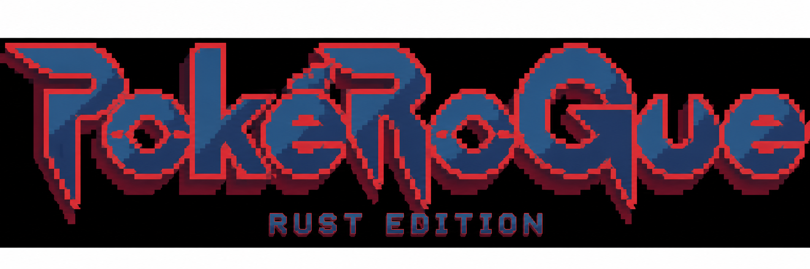
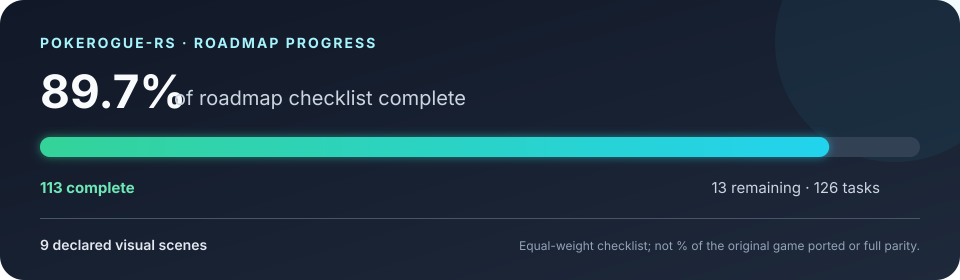
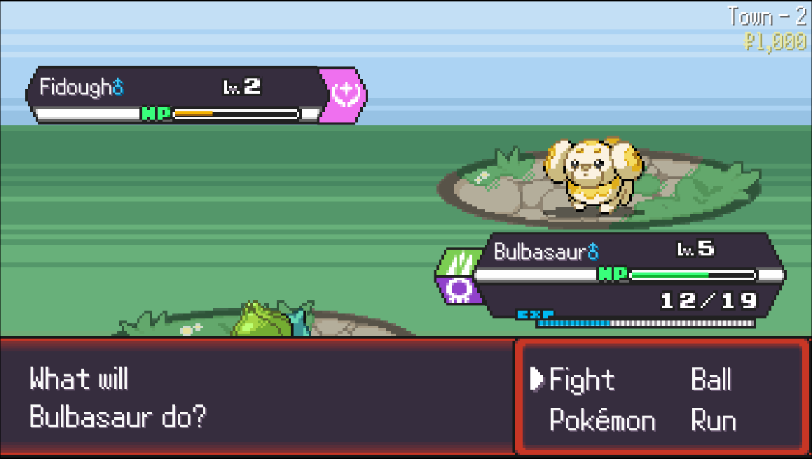

<div align="center">
  

  <p>
    <a href="https://www.rust-lang.org/"></a>
    <a href="LICENSE"></a>
    <a href="ROADMAP.md"></a>
    <a href="tools/visual/README.md"></a>
  </p>
</div>

# PokéRogue Rust

PokéRogue Rust is an **experimental, offline-first reimplementation of a limited part of PokéRogue** in Rust. It is a research and prototyping project, not a complete port or a replacement for the original game. Battle rules and progression run in a Rust core; the Macroquad client handles drawing, audio and input. A pinned TypeScript checkout is used only by local development tools to collect comparison evidence.

<p align="center">
  
</p>

> The chart counts roadmap checkboxes equally. It is a planning aid, not a percentage of the original game implemented. A checked item covers only the explicitly described slice and evidence beside it.

## Current status — 2 November 2026

| Area | Status | Evidence and limits |
|---|---|---|
| Playable client | A local Town mini-run with a title screen, battle UI, move selection, capture/reward slices, and local checkpoint support | See [what works](#what-works-today) and [known gaps](#what-is-not-implemented) |
| Battle and progression rules | Implemented in `pokerogue-core`; imported constants/content live in `pokerogue-data` | Runtime does not need Node.js, a server, or network access |
| Original-source comparison | M12 R1–R5 complete for their bounded scenarios; R6 faint/replacement replay is in progress; R7–R8 are not complete | [Roadmap](ROADMAP.md#next-replay-tasks-bounded-execution-plan) and [evidence log](PORTING_PROGRESS.md#m12-replay-update--r1r5-complete-r6-is-next) |
| Tests | Focused Rust, data-generator, replay-trace, and visual checks exist | The full workspace suite currently has the recorded 20-wave run failure at wave 12; this project does not hide it or treat it as parity evidence |
| Visual comparisons | Local source-backed scene fixtures and replay captures are available | Scene screenshots and asset caches are development-only and are not shipped in the client |

The screenshot below is the latest local gameplay reference capture from the **original PokéRogue**. It illustrates the source UI used for comparison; it is not a claim that the Rust client already reproduces this complete screen.

<p align="center">
  
</p>

Pokémon and game artwork visible in the reference image belong to their respective rights holders. The project does not bundle or claim ownership of the original game's art; see [asset credits and limits](ASSET_CREDITS.md).

## What works today

- Rust workspace split into `pokerogue-core`, `pokerogue-data`, `pokerogue-client`, and `pokerogue-tests`.
- Local Town mini-runs with supported wild battles, turns, selected status/move effects, experience, capture, rewards, and local save/resume slices.
- A Macroquad client with a title/menu screen, Town battle field, HUD, command/move/party/ball selection, basic move presentation, local audio, and a wave-1 entry animation/message.
- Source-backed data and deterministic fixtures for selected encounter, RNG, battle, and progression behaviors.
- A development-only visual harness for comparing bounded scenes against the pinned TypeScript project.
- Source-executed replay traces through a bounded ordinary wave-1 entry and one non-fainting action, with first-divergence reporting.

Each bullet is bounded. It does not imply support for every Pokémon, item, biome, battle mode, move effect, or original-game screen.

## What is not implemented

- The complete PokéRogue ruleset, content database, UI, and run flow.
- Full PhaseManager parity in Rust. The replay comparator maps some source-only phases to semantic Rust action boundaries and reports the missing phase observations.
- Faint/replacement, victory-to-next-wave, and a complete bounded replay gate. These remain open M12 tasks until their original and Rust observations are compared and validated.
- Full 10/20-wave balance parity. The known deterministic twenty-wave test currently loses at wave 12.
- R36S/ArkOS support; it is future-only and has not been validated on that hardware.

See [ROADMAP.md](ROADMAP.md) for milestone order, task acceptance criteria, and current checkboxes. [PORTING_PROGRESS.md](PORTING_PROGRESS.md) records recent validation and known failures. [PARITY_PLAN.md](PARITY_PLAN.md) records which behavior was executed against the pinned original, which is inferred, and what remains unobserved.

## Download, build, and play

### Linux, macOS, and Windows

Install a current stable Rust toolchain with Rust 2024 edition support, then clone the project **with its submodules**:

```sh
git clone --recurse-submodules https://github.com/pontojasko/pokerogue-rs.git
cd pokerogue-rs
cargo run -p pokerogue-client
```

The recursive clone checks out the pinned original source and its nested [`pokerogue-assets`](https://github.com/pagefaultgames/pokerogue-assets) repository at `original/assets` (the game source pins the asset revision used by this project). That is the easiest way to install the art locally: the client looks there automatically when it starts. If you already cloned without submodules, run this from the project root:

```sh
git submodule update --init --recursive
```

To fetch just the nested art checkout after initializing `original`, run:

```sh
git -C original submodule update --init assets
```

You should then have paths such as `original/assets/images/arenas/` and `original/assets/images/pokemon/`. Keep the asset checkout at the pinned revision for reproducible presentation. The client also works without it using fallback graphics. `pokerogue-assets` has separate licensing and third-party art restrictions; downloading it for local play does not grant redistribution rights. See [ASSET_CREDITS.md](ASSET_CREDITS.md) before sharing asset files or builds that include them.

Cargo downloads Rust dependencies on the first build. After dependencies are present, the game client runs locally without contacting PokéRogue servers. The client can still open without art assets, but it will use fallback presentation. Do not distribute builds containing original-game assets unless their separate rights are clear; read [ASSET_CREDITS.md](ASSET_CREDITS.md).

On Linux, the client selects Wayland when `WAYLAND_DISPLAY` is set and X11 otherwise. Set `POKEROGUE_FORCE_X11=1` to choose X11 explicitly from a Wayland session. The project resolves assets relative to its checkout, so it can be launched with Cargo from another working directory.

**Controls:** Enter starts/confirms/restarts; `1`–`4` selects a move; Escape quits. `F5` saves supported local checkpoints. The current run and save scope is intentionally limited; see the roadmap before relying on long runs.

### Play in a browser

The [browser build](https://pontojasko.github.io/pokerogue-rs/) compiles the same `pokerogue-client` binary and Rust core used by the desktop client to `wasm32-unknown-unknown`. It therefore shares the current client screens, controls, and implemented game flow instead of using a separate browser-only battle demo. Saves use browser local storage. Artwork and audio are fetched at runtime from the pinned [`pokerogue-assets`](https://github.com/pagefaultgames/pokerogue-assets/tree/fb8ccb6d0703ffe48cdf80a8102d5ed943c82dba) revision, so the browser build needs an internet connection; those assets are not bundled in this repository or the Pages artifact. The page uses pinned Macroquad/miniquad and `quad-storage` JavaScript loaders. This is the current Rust project's implemented scope, not a claim of complete Pokémon Emerald/PokéRogue parity; see the milestone status and gaps below.

## Project structure

```text
pokerogue-core/       rules, battle state, RNG, progression, saves
pokerogue-data/       generated source-backed data; no runtime importer
pokerogue-client/     Macroquad rendering, UI, audio, and input
pokerogue-tests/      focused integration/parity tests and fixtures
original/             pinned TypeScript reference submodule
tools/visual/         local visual harness and replay capture tooling
scripts/              data generation, comparison, and validation tools
```

The dependency direction is deliberate:

```text
pokerogue-client ──uses──▶ pokerogue-core ──uses──▶ pokerogue-data
       ▲                         ▲
       └── presentation/input    └── rules, RNG, progression, persistence
```

Rendering and input belong in the client. Rules, randomness, progression and persistence belong in the core. Node/TypeScript is a development-time reference and generator only; it is not a runtime requirement.

## Checks for contributors

```sh
cargo fmt --all -- --check
cargo check --workspace --offline
cargo test --workspace --offline
cargo parity
node scripts/import_demo_data.mjs --check
node tools/visual/replay-trace.test.mjs
node tools/visual/replay-compare.test.mjs
```

Some checks require the submodules and local visual tools. `cargo parity` currently includes the known failing 20-wave policy test. Do not update fixtures to make a failed comparison green without first verifying the behavior against the pinned source. See [CONTRIBUTING.md](CONTRIBUTING.md) for focused checks and evidence expectations.

## Visual comparison tooling

The visual harness writes captures, diffs, and reports under the ignored `visual-artifacts/` directory. It does not connect to official game servers. To install its development-only Node dependencies and run a scene:

```sh
npm ci --prefix tools/visual --ignore-scripts
python3 tools/visual/bootstrap.py
python3 scripts/visual_parity.py --scene battle-town-capture
```

Native screenshots can require a display server; Xvfb setup and Playwright/Helium prerequisites are documented in [tools/visual/README.md](tools/visual/README.md). Visual fixture output is not an automatic parity claim, and local original-game captures/assets are not part of the normal runtime.

### Game Boy CSS reference

The [M12 status card in the roadmap](ROADMAP.md) is a static PNG rendered from the standalone [Pokémon GameBoy CSS](https://github.com/luttje/css-pokemon-gameboy) framework. GitHub does not apply arbitrary CSS to repository Markdown, so the rendered image is how that styling appears here. The upstream project is MIT-licensed, but says its imagery and visual style are Nintendo's property; see its [README](https://github.com/luttje/css-pokemon-gameboy#third-party-licenses). We do not add the library as a runtime dependency.

## Contributing and project transparency

Start with [CONTRIBUTING.md](CONTRIBUTING.md). Before changing rules, read [ARCHITECTURE.md](ARCHITECTURE.md), the relevant [PARITY_PLAN.md](PARITY_PLAN.md) section, and the task dependencies in [ROADMAP.md](ROADMAP.md). Every completion claim should point to a reproducible command or checked-in evidence; a passing narrow test must not be presented as full-game parity.

This is an unofficial fan project and is not affiliated with PokéRogue's authors or Pokémon rights holders. The Rust workspace uses **AGPL-3.0-only**; see [LICENSE](LICENSE). The original source and assets are separate submodules with their own licenses, notices, and restrictions.
