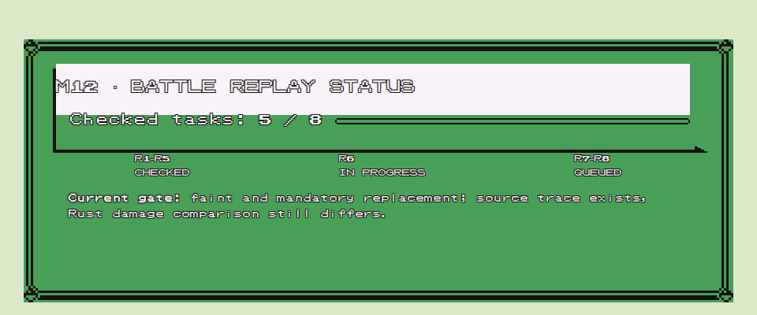

# Offline Rust port roadmap

Milestones are functional slices. Close each only when its criteria pass and its parity limits are recorded in `PARITY_PLAN.md`. Keep the order unless evidence or a dependency justifies a change.

## How to read this roadmap

- A checked item means the bounded slice described by that item is implemented and has the evidence noted beside it; it does not mean the complete original-game flow is ported.
- The README pixel chart counts checklist items equally. It is a planning aid, not a percentage of PokéRogue reimplemented in Rust.
- Every open item should be completed in a small change: identify the pinned TypeScript behavior, add or extend a deterministic source fixture, implement the Rust slice, validate it, and record uncovered cases in `PARITY_PLAN.md` and `PORTING_PROGRESS.md`.
- Keep the native runtime offline. The separate browser demo is a static-hosted exception and fetches presentation images from the pinned upstream asset repository; it adds no gameplay server or multiplayer.
- Preserve unresolved asset licensing boundaries. Local visual tests may read the submodule assets; do not copy restricted assets into tracked project files.

## Current execution priority — reviewed 2026-11-01

Prioritize M12 differential replay groundwork before additional M11 pixel polishing or M13 content expansion. This dependency-based scheduling change does not close M11 or any earlier incomplete item; preserve existing visual regression gates. Current validation and the known twenty-wave failure are in [PORTING_PROGRESS.md](PORTING_PROGRESS.md), with previous measurements in [PORTING_HISTORY.md](PORTING_HISTORY.md).

Dependency order: real ordinary wave entry and initial queue → entry RNG/state comparison → one action through the real phase manager → faint/replacement → victory/reward handoff → multi-wave replay. Reuse existing method fixtures as lower-level checks; do not substitute their stubs for the phase behavior being tested.

Current M12 execution snapshot (2026-11-02): R1–R5 have bounded checked evidence; R6 is in progress and has not met its paired-trace/Rust-comparison criterion; R7 and R8 are not started. This ordering is a dependency plan, not an estimate of completion percentage. Each task below remains open until its listed acceptance and validation evidence is recorded.

  

This static status card was rendered from the [Pokémon GameBoy CSS framework](https://github.com/luttje/css-pokemon-gameboy) so the visual appears in GitHub Markdown, which does not apply external stylesheets. Its 5/8 count refers only to checked M12 tasks; it is not an estimate of overall game parity.

The first bounded task is one source-executed Town wave-1 entry trace and comparison with existing Rust entry fields. Record provenance, controlled inputs/collaborators, ordered RNG draws, encounter/party state and initial queue. A repeatable first mismatch is a useful diagnostic result, not a parity pass. Do not change production rules to conceal it. The twenty-wave policy test remains a separate Rust completion test until an original replay exists.

## Experimental WebAssembly demo (outside milestone parity)

- [x] Add a small `pokerogue-web` target that runs the Rust core's Town battle slice in a browser; the Macroquad renderer accepts move keys `1`–`4` and restarts with `R`.
- [x] Cross-compile the release target for `wasm32-unknown-unknown` and exercise the page in a browser; the Town scene, source sprites, one move input and restart rendered without console/network errors.
- [x] Publish the static output on [GitHub Pages](https://pontojasko.github.io/pokerogue-rs/) and verify the live build; workflow run [41480783949](https://github.com/pontojasko/pokerogue-rs/actions/runs/41480783949) completed successfully, and the live browser smoke check passed.
- The demo fetches only the selected images and sprite atlases directly from pinned `pokerogue-assets` at runtime. Its Pages artifact does not contain those image files. Images therefore need an internet connection; this is not a full replacement for the offline native client.
- This UI is a compact first-wave presentation, not full client parity. It does not include native save handling, reward flow, sound, starter selection, or wave continuation. Gameplay state and actions still go through `pokerogue-core`.

## M0 — battle foundation (complete, Stages 1–13)

- [x] Workspace split into core/data/client/tests; offline Macroquad battle runs.
- [x] Initial combat, RNG, bounded wild AI, action ordering, voluntary and mandatory switching slices exist.
- [x] Import original base move PP, track consumption across waves, and persist it in local checkpoints; PP Max is source-backed, Pressure remains open, and Struggle fallback is implemented.
- [x] Differential evidence and known gaps are tracked in `PARITY_PLAN.md`.

## M1 — data import pipeline (complete for first-wave Town Pokémon pools)

- [x] Build deterministic local tooling to extract species and move data from the pinned TypeScript source into `pokerogue-data`.
- [x] Import the initial bounded prototype subset (two species, six moves); expansion to encounter data remains open.
- [x] Verify generated output with `node scripts/import_demo_data.mjs --check`; runtime requires no Node/network, and tests compare imported scalar fields to the source-extracted fixture.
- [x] Record data provenance and scope in `pokerogue-data/README.md`; do not bundle assets whose redistribution rights are unresolved.
- [x] Import a fixed first-wave data context: initial `TOWN` biome's `COMMON/ALL` species pool, matching species/base stats, numeric level-up moves, and referenced move metadata.
- [x] Expand extraction to all 9 rarity tiers × 5 time buckets in Town, without implementing encounter selection.
- [x] Check imported pool order, all imported learnset move IDs, and generated species/move fields against source-declaration fixtures.
- [x] Extract and check normal/boss tier roll weights plus time, override, forced-tier, and luck-bound conditions from the pinned source.
- [x] Import direct TM lists and tier/unimplemented metadata for the same species and compare source-ordered starter-party compatibility candidates against executed original methods.

## M2 — first wave and encounter loop

- [x] Port one bounded source-defined first-wave Town `Arena.randomSpecies` path using imported data and a deterministic seed.
- [x] Run generated encounters from wave entry to victory/defeat offline for the fixed five-wave Town scenario.
- [ ] Compare each wave's generated level, rarity/species, learnset projection, stats, EXP and RNG against the actual `BattleScene.newBattle` seed path. Existing fixtures execute the isolated original methods but omit Battle's seeded `battleSeed` initialization and the wild double check; do not count them as normal Classic wave-entry parity.
- [x] Keep the implemented encounter selection and generated entry rules in core, not Macroquad.

## M3 — experience and levels

- [x] Port one bounded wild-victory XP award path and level-up threshold/stat update.
- [x] Compare exact EXP/level transitions against executed `getMaxExpLevel` and `Pokemon.addExp` fixtures, including Classic wave caps and level-100 clamp.
- [x] Compare no-modifier participant split and max-level exclusion against executed `applyPartyExp` scenarios.
- [x] Match participant EXP FIFO order using executed `BattleScene.applyPartyExp`, `PhaseManager.unshiftPhase` and `PhaseTree` methods; the full nested battle phase flow remains open.
- [x] Compare bounded `calculateStats`/HP adjustment after single and multiple level gains against executed original methods.
- [x] Execute `PokemonFriendshipBoosterModifier` arithmetic for zero through three Soothe Bell stacks; apply it to Rare Candy and the bounded +3 living-participant battle-friendship path; persist held stacks in checkpoint v24.
- [x] Learn direct-species level-up moves in source queue order; support empty slots, full-moveset replacement/decline, PREVO informational reminders, per-member EXP/LevelUp prompt ordering and checkpoint v27 persistence. Compare imported Silcoon/Wurmple candidates and controlled duplicate/range boundaries against executed `getLevelMoves`/filter methods. Other families and full PhaseManager/ExpPhase execution remain open.
- [ ] Compare participant modifiers, full `LevelUpPhase`/`ExpPhase` scheduling, all friendship sources, and complete phase-queue ordering as one source flow. The no-modifier participant split, nested FIFO move/reminder prompts (`ExpPhase.start` + `Pokemon.addExp` + queue methods + `LevelUpPhase.end` + `PhaseTree`), and +3 battle-friendship branch have bounded source-method fixtures; modifiers, full phase construction/callback scheduling and battles remain open. Do not count these as full phase parity.
- [x] Preserve battle/team state and HP across the bounded level-up update.

## M4 — basic rewards

- [x] Port the fixed Classic EXP Charm reward scheduled by `VictoryPhase` for the supported waves, including its stacking effect on subsequent EXP awards.
- [x] Match the Classic wave 1–20 SelectModifier/fixed EXP Charm/Super EXP Charm schedule, 25%/60% multipliers and stack caps against a source-executed TypeScript fixture.
- [x] Support bounded ULTRA EXP Share: source-execute offer RNG and party EXP distribution, integrate claim/victory/save, and test v18→v19 migration.
- [x] Support bounded ULTRA Amulet Coin direct money effect and v19→v20 save migration; exact offer RNG trace remains open.
- [x] Match source retry behavior when a generated candidate is null, including same-tier redraws and exact Phaser RNG order in a controlled COMMON scenario.
- [x] Implement bounded source-verified post-battle offer/claim loops using deterministic RNG (COMMON plus selected GREAT identities/effects).
- [x] Match supported offer candidates, selection, relevant state changes, and RNG against executed source fixtures; wider tier coverage remains open below.
- [x] Keep unsupported reward types explicitly unavailable rather than approximated.
- [x] Bounded guaranteed reward configuration: Poké Balls/Potion/Super Potion, selection, application and v5 saves; source-executed consumable fixtures. Natural random distribution remains open.

## M5 — local saves

- [x] Define a versioned local save format for the supported between-wave run state.
- [x] Test round-trip, invalid/corrupt input, and unsupported-version rejection without network services.
- [x] Keep serialization in core and atomic filesystem writes in the client.

## M6 — first offline mini-run

- [x] Complete winning Town runs under the corrected source reward cadence; deterministic ten- and twenty-wave runs include boss victories and supported natural reward claims.
- [x] Save/resume winning runs between waves, including the ten- and twenty-wave checkpoints; mid-battle saves remain unsupported.
- [x] Pass workspace validation and document known rule/data gaps; this does not imply wider 1:1 parity.
- [x] Add bounded source-verified selectable modifier offer/claim loop (M4); unmodeled generated rewards remain withheld/fallback-labeled.

## M7 — ordinary wild capture

- [x] Import original species catch rates and implement source-derived multipliers for all six Poké Ball types.
- [x] Execute the pinned ordinary-wild `AttemptCapturePhase` formula and RNG checks in deterministic success/failure fixtures.
- [x] Expand the local team and checkpoint roster to the source-defined six-Pokémon capacity.
- [x] Add successfully captured ordinary wild Pokémon to the local party (up to six) and preserve party plus ball inventory across waves and version 4 saves; reject full-party and no-ball commands without mutation.
- [x] Integrate `Throw Poké Ball` as a battle command; failed attempts continue to the opponent action and successful attempts end the encounter.
- [ ] Implement box/full-party replacement, other battle balls in run inventory, and boss/challenge capture rules; remain explicitly unsupported.

## Pending parity prerequisite — Stage 13 faint continuation

- [x] Execute the original inactive-user guard in `MovePhase.start` and `TurnEndPhase.start` in isolated source wrappers; Rust fixture assertions cover those method outputs.
- [x] Core tests cover enemy-first faint, forced replacement, event order, turn continuation, and no extra action/RNG draw on replacement.
- [ ] Execute the complete enemy-first faint phase queue in Phaser, including cancellation and continuation through the real `PhaseManager`.
- [ ] Keep this scope gap visible while progressing the data pipeline; complete before claiming phase-accurate faint handling or expanding faint contexts.

## Cross-cutting completion gate

For each milestone: identify the pinned TypeScript implementation; implement one bounded slice; create executable original-source fixtures where practical; assert state/event/RNG behavior; run focused checks during iteration and the full milestone validation from `AGENTS.md`; update `PORTING_PROGRESS.md` and `PARITY_PLAN.md`. Full parity is never inferred from Rust-only tests.

## M8 — ten-wave run (open)

- [x] Source-executed isolated natural PLAYER rarity roll, luck upgrades and tier fallback.
- [x] Source-executed complete COMMON raw weight callbacks (15 contexts), ordered IDs, percentage-rounded HP and PP eligibility; live MiniRun party/ball mapping is compared to a source fixture.
- [x] Source-executed existing-modifier stack-cap gate and no-challenge duplicate candidate retry loop.
- [x] Deterministically extract 86 ordered PLAYER modifier pool IDs and literal/max weights from the pinned source; callback weights are explicitly marked dynamic.
- [x] Source-execute one natural wave-one COMMON candidate, including the wave-shifted RNG draws and pool-index-to-POKEBALL lookup.
- [x] Source-execute and compare a seeded three-option COMMON offer including duplicate-group retry and shared RNG order; generated types/runtime claim integration remain open.
- [x] Execute the original COMMON Temp Stat Booster, Berry and TM generator callbacks for controlled seeds and compare generated variants and RNG draw order in Rust; compatible TM IDs are source-filtered inputs, not imported data yet.
- [x] Match one source-executed same-tier recursive retry when a generated modifier returns null, including exact Phaser draws and the resulting COMMON candidate.
- [x] Compare the 100-failure tier fallback using the source TM callback with no compatible moves and exact Phaser RNG state.
- [x] Import direct base-species TMs, referenced moves, source TM tiers, and unimplemented flags; compare compatibility candidates for Bulbasaur, Charmander and their initial party against executed source methods.
- [x] Import source-derived direct prevolution links for imported Town species and recursively include family TMs; compare Silcoon's inherited Wurmple TMs against the pinned `getTms`/`getCompatibleTms` path.
- [ ] Add evolution-family level-move exclusions, regional forms, fusions/challenge filtering and used-TM state to player compatibility.
- [x] Execute and compare bounded raw GREAT/ULTRA/ROGUE/MASTER pool weight callbacks and ordered pool IDs against pinned TypeScript methods.
- [x] Correct the modifier catalog importer to strip comments lexically; source execution and generated catalog now retain all 86 ordered entries, including all 26 ULTRA options.
- [x] Port the existing-stack cap gate over source-ordered imported pool weights while preserving pool indexes.
- [x] Compose live two-member MiniRun COMMON weights with one wave-seeded PLAYER candidate; compare candidate ID/pool index and RNG trace against the executed TypeScript oracle.
- [x] Compose a three-choice MiniRun offer for a deterministic all-COMMON seed, including duplicate-group retry and RNG trace; reject any offer that touches an unsupported tier.
- [x] Apply Lure from a natural COMMON offer, match lapse/refresh, use remaining duration for COMMON weighting, and persist it in checkpoint v9 (migrates v4–v8).
- [x] Display and claim the bounded all-COMMON offer in Macroquad; keep higher-tier fallback explicitly labeled as the legacy test reward configuration.
- [x] Apply/persist all six source-generated Temp Stat Booster variants, integrate the four newly modeled offensive/defensive stages, preserve five-battle lapse/refresh, and migrate checkpoint v11 to v12.
- [x] Execute and implement the bounded Sitrus Berry HP predicate/heal, natural COMMON claim and save v14 migration from v12/v13.
- [x] Add source-backed direct applications for Rare Candy, Ether, and Max Ether, preserving level/EXP/PP in local checkpoints; natural selection/UI wiring remains open.
- [x] Apply Rare Candy's original +6 capped friendship change, import source base friendship, and persist/migrate per-member friendship in checkpoint v23; booster/starter-candy side effects remain open.
- [x] Source-executed Town encounter inputs for waves 1–10, including the wave-10 boss level/RNG path, Town tier fallback, generated species/stats/moves projection and segment count. Full Phaser construction remains outside the fixture.
- [ ] Finish remaining boss/capture and end-of-biome differences; ordinary shield damage, wild-boss shield boosts, and the ordinary ball gate are source-backed, while the full Phaser phase manager and special boss cases remain open.
- [x] Complete/play/save/resume a ten-wave run under the corrected schedule; `MiniRunSeed0001` clears wave-10 boss and round-trips the boss checkpoint. Battle result parity remains Rust-only.
- [ ] Complete natural offer coverage for all tiers/effects and remove the legacy guaranteed test fallback; current live path accepts fully resolved COMMON offers but only a subset of generated effects.
- [x] Validate wave-10 encounter creation inputs and Classic `VictoryPhase.start` fixed reward ordering against executed source methods; the local ten-wave run also tests its bounded checkpoint/completion path.
- [ ] Execute the full wave-10 Phaser phase-manager/new-battle or biome-transition path; `VictoryPhase.start` now forwards through source `PhaseManager.pushNew`/`pushPhase` and `PhaseTree`, and `BattleScene.newBattle` plus seed reset/scoped RNG are source-executed with controlled collaborators. Phaser phase execution, real battle/arena construction, dynamic double/mystery selection and actual run cleanup remain unexecuted.
- [x] Execute the original segmented-boss capture guard for ordinary shields, final segment and source exception cases; Rust compares ordinary Poké/Great Ball blocking/opening.
- [x] Execute `EnemyPokemon.handleBossSegmentCleared` and `weightedPick` for four controlled wild-boss cases; apply weighted stat boosts and exact RNG order from normal damage in the supported Town battle slice.
- [x] Resolve natural GREAT Full Restore with original `potion` group; compare seeded option selection/RNG and `PokemonHpRestoreModifier.apply`, and persist the resulting HP through the local checkpoint (status reset remains unsupported).
- [x] Resolve natural GREAT Soothe Bell with its source no-group behavior; compare seeded option IDs/indexes/RNG and held-item friendship arithmetic, then persist per-member stacks in checkpoint v24.
- [ ] Port final-boss, challenge, daily-boss, Wonder Guard and Master Ball exceptions once their corresponding battle state and ball inventory are represented.

## M9 — twenty-wave Town extension (playable; phase parity open)

- [x] Add a selectable twenty-wave client run while retaining ten-wave mode; core supports both endpoints and legacy saves retain 20 waves.
- [x] Source-execute Town encounter creation inputs for waves 11–20, including the wave-20 boss level draw, and compare species/tier/pool index, stats, move projection, EXP and RNG trace.
- [x] Complete and resume a winning twenty-wave run under corrected Classic reward cadence. `MiniRunSeed0667` defeats both bosses, claims a supported GREAT recovery item, and round-trips save checkpoints at wave 1, 10 and 20 before completion. The deterministic Rust policy/outcomes are not TypeScript battle parity.
- [x] Port the one-usable-move Harden case and no-usable-PP Struggle fallback, including self DEF, typeless damage, recoil and no-accuracy-roll shortcut.
- [x] Natural COMMON offers remain bounded; GREAT includes Great Ball, PP Up, Nugget, Hyper/Max Potion, Full Restore (HP only), Soothe Bell, Revive/Max Revive, Elixir/Max Elixir and source-generated TM; ULTRA supports bounded PP Max, Ultra Ball, EXP Charm, EXP Share, Big Nugget and Amulet Coin with local save persistence. Other GREAT candidates and higher tiers still fall back to the labeled test reward list.
- [x] Execute the pinned `VictoryPhase.start` body in a recording harness for Classic waves 1–20; compare natural offer and fixed EXP reward ordering against Rust cadence.
- [x] Expand the core moveset storage and local checkpoint format to four move slots; validate v21 round-trip and legacy save migration.
- [x] Execute the pinned `LearnMovePhase.start` method body in a wrapper; port duplicate rejection and learning into an empty moveset slot.
- [x] Make a source-generated COMMON TM offer claimable for an imported compatible party member; persist learned moves in v21 saves.
- [x] Replace a selected move for a full four-slot set, persist per-Pokémon used-TM IDs in checkpoint v22, and migrate v21 saves.
- [x] Route a selected GREAT TM through compatible-member learning/replacement and v23 used-TM persistence; natural GREAT TM option/RNG parity remains open below.
- [x] Execute and compare one three-option COMMON TM offer, including the original TmModifierTypeGenerator, source party candidates, final options, pool indexes and all RNG draws.
- [x] Execute one source-backed GREAT TM offer and compare options/pool indexes/RNG; broader eligibility and other TM tiers remain open.
- [x] Execute pinned `NewBattlePhase.start` and `BattleScene.getNewBattleProps` default paths; compare their phase call order and next wild wave against local continuation for waves 1–19.
- [ ] Execute the full Phaser phase-manager flow for wave 20 boss entry, defeat, reward offer, and continuation. The local 20-wave endpoint intentionally completes after wave 20, while source Classic queues `NewBattlePhase` and continues to wave 21. The harness does not execute the full body of `BattleScene.newBattle` or the Phaser PhaseManager.
- [x] Source-execute and integrate the GREAT PP Up move filter/application and `getMovePp` arithmetic; target selection is keyboard-accessible and PP Up state persists in current checkpoints.

## M10 — battle/run presentation (complete; visual parity open)

- [x] Replace static text panels with a framed battle field, differentiated HP cards, party HP strip, command panel, and reward choice cards; keep Macroquad presentation-only.
- [x] Use a centered 960×540 logical viewport with aspect-preserving letterbox scaling, including 640×480 window sizes; this is not an R36S compatibility claim.
- [x] Show supported natural offer tier and three choices plus current target; preserve keyboard selection controls.
- [x] Show level-up move gains on the inter-wave reward screen; core emits the event and Macroquad only renders imported move names.
- [x] Show full-moveset level-up choices with four replace slots, Enter to decline and F5 save; input dispatches only to core resolution.
- [x] Render move choices as selectable, type-colored cards showing power/status and remaining PP; display the most recently selected move.
- [x] Replace the flat playfield with a layered stepped Town backdrop; add a local mini-run launcher with original battler sprites and 10/20-wave choices. This was not the original Phaser title screen; title parity is tracked under M11.
- [x] Load the pinned local Town background, battle-info/HP panels, and source frame metadata for the Town species atlas; asset files remain local because redistribution rights are unresolved.
- [x] Render Town A/B arena platforms at source-settled Phaser positions and port the 2s first/next-wave entrance offsets for arenas, battlers, and HP panels; port faint fall/hide, capture throw/shrink/bounce/shake timing, and Poke/Great opening particles. Biome transitions, Ultra particles, capture success stars/recall, boss forms and audio remain open.
- [x] Port the bounded Tackle/Ember graphic-target animations from their original JSON/spritesheets, including frame timing, alpha/zoom, and source USER_TARGET projection; other target modes, effects, timing and assets remain open.
- [x] Mark segmented boss HP divisions and show an explicit boss segment badge without moving battle rules into the client.
- [x] Client compiles and smoke-launches; ten/twenty-wave modes remain selected from the title screen. Run behavior is unchanged.

## M11 — paired visual coverage (in progress)

The reusable local capture and comparison loop is in place. Expand it one deterministic screen or animation at a time; keep gameplay parity gaps above open until the full relevant source flow is exercised.

- [x] Add shared 960x540 Town DAY fixtures, frozen presentation sampling and native PNG export mode.
- [x] Add local-only Playwright/Helium runner, source-executed ArenaBase harness and pixel/report tools.
- [x] Add tested comparator regression gates; explicit local baselines only, no automatic acceptance.
- [x] Validate real reference/Rust captures end-to-end with Helium and isolated Xvfb; no desktop interaction.
- [x] Review/correct settled field, mid-entry and atlas-frame differences using actual image reports; residual rasterization pixels remain disclosed.
- [x] Execute source HUD constructors/text/level/HP digits and correct native font, labels and HP atlas selection.
- [x] Execute original `FightUiHandler.displayMoves` for a shared Vine Whip/Tackle fixture; align Rust move labels, empty slots and UI placement using the captured reference.
- [x] Boot the pinned Phaser application locally in Helium and capture the real `BattleScene` command and move-selection screens; compare them against Macroquad without desktop input.
- [x] Add arrow-key navigation, Enter/Z confirmation, and X cancellation for battle commands, move selection, balls, and party selection while retaining existing shortcuts.
- [x] Correct command prompt line spacing and replace font-dependent cursor characters with a pixel cursor based on real full-game captures.
- [x] Use source type/category atlas frames, real captured gender presentation metadata, and the selected move's type-effectiveness indicator in battle HUD states.
- [ ] Reduce remaining command/move screen differences; latest archived full-game command/move measurements are 2.0231% and 3.0569%; see PORTING_PROGRESS.md for scope and validation date.
- [x] Capture a deterministic Tackle frame using the original `BattleAnim.getGraphicFrameData` projector and source animation asset; add a separate parity threshold and local Rust regression baseline.
- [x] Capture the 250 ms Poké Ball throw from original `AttemptCapturePhase.start`; add a separate parity threshold and local Rust regression baseline.
- [x] Establish reviewed local baselines for nine bounded cases; execute automatic graphical regression checks.
- [ ] Drive complete Phaser attack/capture/reward/transition phases and compare each corresponding Macroquad presentation state; current full-game capture coverage is command and move selection only.
- [ ] Add a deterministic paired Phaser/Macroquad capture-animation frame; current capture timing and atlas checks do not compare rendered pixels.
- [x] Capture the executed Phaser title screen and Rust title launcher at 960×540; produce a paired pixel-difference artifact and retain the visual gaps in the parity ledger. This closes capture coverage only, not title-screen parity.
- [x] Add the source-styled reward selection layout with real item atlas frames, namebox, description panel, selected cursor and reveal/idle animation. Compare its fixed Soothe Bell/PP Up/TM091 fixture to the user-supplied original screenshot (6.7449% changed pixels at zero tolerance); this does not execute `SelectModifierPhase`.
- [x] Render the pinned-source Pokémon party-selection screen from its local background, slot, icon, HP and cancel assets; match vertical slot navigation/cancel behavior and `PokemonIconAnimHelper` active/passive idle bob. Compare a two-member fixture against the supplied 1600×897 screenshot (22,170/516,480 pixels differ after point downscale to 960×538). This is screenshot comparison, not an executed `PartyUiHandler` parity claim; gender/status edge cases remain open.
- [x] Rebuild the Poké Ball list with the five original local atlas icons, right-aligned counts, underlying command prompt/menu, original cursor navigation and `BallUiHandler` wiggle tween. Compare a deterministic Town/Rattata fixture against the supplied 1740×977 screenshot (21,840 changed pixels, 4.22%, at zero tolerance after point scaling to 960×539); Rogue/Master remain zero-count display rows and cannot trigger unsupported gameplay.

See `tools/visual/README.md`. The bounded harness is not the full original game and is not visual parity certification. Capture failures and the known twenty-wave gameplay test failure remain visible.

## M12 — battle phase and action parity (open)

Goal: replace isolated method-level evidence with reproducible, source-executed battle flows for the supported Town slice. Do not describe a fixture as full battle parity unless the original phase queue, RNG calls, and state transitions that own that behavior are executed.

- [x] Add deterministic replay trace metadata and a first-divergence report for ordered RNG/state/phase observations; start with one ordinary Town wave-1 entry and expand only after its dependencies are understood. R1 evidence: `node scripts/capture_town_entry_trace.mjs --check pokerogue-tests/fixtures/town-wave1-entry-trace.json`; the 38-observation trace ends exactly at `newBattle.end`, with pinned source/assets, actual DAY/TOWN boundary and queued `EncounterPhase`.
- [x] Build a pinned-source harness for normal `BattleScene.newBattle` construction, including `battleSeed` initialization, encounter selection, the wild double check, party/opponent construction, and the resulting initial phase queue. R2 evidence: `town-wave1-command-trace.json` executes the actual PhaseManager through Encounter/Summon/InitEncounter/PostSummon/TurnInit to CommandPhase; two source runs match, 269 observations include direct `frac()` calls, fixture `--check` passes and a 1ms timeout probe reports last phase/queue.
- [ ] Compare wave-entry RNG draw order and encounter state against the existing Rust fixtures for waves 1–20; preserve separate cases for ordinary and segmented boss encounters.
- [ ] Execute player and enemy action ordering through the original phase manager for a bounded single-move battle; compare selected move, targets, accuracy/critical/damage draws, HP, faint state, and queued follow-up phases.
- [ ] Complete enemy-first faint continuation through queued phase cancellation, forced replacement, turn-end, and next-turn selection. Keep the current isolated inactive-user guards as narrower evidence until this flow passes.
- [ ] Exercise status-only and mixed attack/status move selection, PP exhaustion and Struggle fallback through the original battle flow; add only behavior supported by source execution.
- [ ] Execute one end-to-end victory flow through EXP, level/move prompts, reward generation/claim, and next-wave handoff for the ten-wave endpoint.
- [ ] Add the corresponding wave-20 boss victory and Classic continuation case; document the intentional local endpoint difference if the Rust mini-run still ends at wave 20.
- [ ] Keep any unsupported PhaseManager callbacks, modifier interactions, and battle modes listed individually in `PARITY_PLAN.md` rather than rolling them into a broad parity claim.

### Next replay tasks (bounded execution plan)

These eight tasks refine the open M12 items above, rather than adding milestones or changing their completion status. Execute in dependency order. Trace capture/comparison may finish with an explicit mismatch; behavioral parity requires matching observations from executed original code. Keep evidence in PARITY_PLAN.md and current results in PORTING_PROGRESS.md, without duplicating this plan there.

1. **R1 — Capture one real wave-entry boundary. Dependencies: none. Complete.**
   Inspect/reuse the local application bootstrap in `tools/visual/capture-original-game.mjs`, but inventory and remove gameplay overrides from the replay path. Run pinned `BattleScene.newBattle` for one fixed Classic Town DAY wave-1 scenario. Specify starter input and the observation boundary; do not claim enemy construction at this boundary, since `original/src/phases/encounter-phase.ts` creates enemies later. Record source/asset revisions, Phaser version, seed, controlled collaborators, initial RNG state, ordered seed-offset/draw operations, battle metadata and initial phase queue in a versioned development-only trace. Do not stub the battle/RNG/queue behavior being measured.
   Acceptance: two fresh-process runs produce identical canonical traces; timestamps/browser identity are excluded from comparison; missing source/assets or an unexpected path produces an explicit failure. Validation: run the scenario twice, compare traces byte-for-byte and verify source pin; add generator `--check` support and exercise stale-output rejection. This task captures evidence only, with no production rule changes.

2. **R2 — Observe encounter construction through first command. Dependencies: R1. Complete.**
   Advance the real PhaseManager through `EncounterPhase` to the first player command. Observe phase enqueue/start/end boundaries and capture party/enemy IDs, level, IVs, nature, ability, stats, moves/PP, HP and RNG operations. Distinguish input party from generated opponent state. Reuse the bootstrap, not screenshot-specific forced enemies or synthetic phase history.
   Acceptance: repeated captures match; a bounded timeout reports last phase/queue instead of hanging; no unsupported callback silently succeeds. Validation: two runs plus a timeout/failure probe; generator `--check`. Document each unavoidable UI-only substitute and confirm it does not replace gameplay execution.

3. **R3 — Export the existing Rust entry and report first divergence. Dependencies: R1–R2. Complete.**
   Use `generate_town_wild_encounter_for_wave`, Battle entry constructors and existing integration fixtures in `pokerogue-tests/src/lib.rs`. Add a test/development adapter for the same seed/input and a comparator reporting scenario, boundary, field or RNG index, expected and actual. `RngDraw` currently exposes turn/range/min/value; `Battle::rng_draws` is not a complete entry-stream or PhaseManager trace. Mark missing observations explicitly and compare semantic boundaries, not an invented Rust phase queue.
   Acceptance: identical traces pass; changed RNG value, reordered/missing operation, HP mismatch and schema/provenance mismatch fail at the first relevant observation. Unobserved required fields prevent a parity pass. Validation: focused comparator contract tests and one actual original/Rust entry comparison; fixture `--check`. A stable known mismatch is diagnostic output and remains visible.

4. **R4 — Resolve the first supported entry divergence. Dependencies: R3. Complete for the bounded entry state.** Both opponents, seed/constructor/modifier RNG and all 28 integer draws through the first-command boundary match. The replay bootstrap waits for scene `gameData`; gender/starter/save-slot input uses original handlers. An optional 8x presentation timer/tween scale after starter selection, restored to 1x at CommandPhase, lets source callbacks finish under software-rendered capture without changing RNG. Bootstrap/input diagnosis confirmed that the 1000 ms source confirmation timer was slow under software rendering; later instrumentation diagnosis found 18 duplicate command-boundary observations and a marker attached to source phase instances. The harness-local WeakSet now records one boundary without mutating source objects. Two independent captures reached `CommandPhase` and canonicalized identically; after the instrumentation fix, fixture generation and a separate fresh `--check` capture passed with 256 observations. Canonical identity excludes only `command_boundary_state.clock.now` and `active_clock_events`. Rust now matches the one-member Bulbasaur party (stats and moves) and both opponents. `cargo test --offline -p pokerogue-tests normal_town_entry_consumes_double_check_before_encounter_rng` passes; replay trace/comparator contract tests pass. `node scripts/compare_town_entry.mjs` has no observed state divergence (`first_divergence: null`) but reports `incomplete-observations`: Rust phase-manager execution/initial queue is not implemented or claimed. R5 explicitly maps source-only internal phases to semantic Rust command boundaries; see PORTING_PROGRESS.md.**
   Select only the earliest causally relevant discrepancy supported by the original trace; capture a failing regression before any correction. If it requires unmodeled constructor state, explicitly add that prerequisite to this task before action parity can proceed. Preserve source ordering, including seed offsets and constructor draws; do not force IVs/nature/species merely to match the existing Rust projection.
   Acceptance: the selected mismatch disappears and the comparator either reaches a fully matched entry boundary or identifies the next mismatch. Repeat as separate bounded increments until the entry precondition for R5 is satisfied; never declare the entire task passed from one repaired field. Validation: focused regression, existing encounter/RNG fixture tests and relevant generator `--check`; importers `--check` if imported data changes. Behavioral fixes belong in core/data, with no Node runtime dependency.

5. **R5 — Replay one non-fainting action sequence. Dependencies: R4 with matched entry fields required by combat. Complete for the bounded first-move case.**
   `town-wave1-action-trace.json` executes source Fight/FightUiHandler inputs, selected enemy Tackle, both source MovePhases, TurnEnd/TurnInit and the returned CommandPhase. Its 354-observation fixture has exactly two command-boundary snapshots; generation plus a separate fresh `--check` passed. The comparator maps source target battler indexes 2→Rust enemy and 0→Rust player, and checks actor/move order, selected enemy move, both moves' PP, before/after HP, turn, and the ordered battle RNG draws. Stack evidence located the missing first draw in `EnemyPokemon.getNextTargets`: source draws the target-benefit weight (8) even with one target. Core now reproduces that draw, base 1/24 critical checks, source critical damage multiplier 1.5 and critical stage rules for the modeled damage slice. `cargo test --offline -p pokerogue-tests town_wave1_first_move_matches_source_rng_and_next_command_state`, `node tools/visual/replay-compare.test.mjs` including changed-command/draw negative cases, and `node scripts/compare_town_action.mjs` pass its `action` report. All seven battle-seeded draws match source exactly: target `(8,0,5)`, player accuracy/crit/damage `(100,0,9),(24,0,12),(16,85,90)`, enemy `(100,0,24),(24,0,9),(16,85,88)`; no critical hit occurs in this sample. The semantic entry party (IDs/stats/HP/moves/PP) is matched for the action seed. The companion `entry` diagnostic reports four extra Rust phase-scheduler offset draws because its adapter flattens offset-scoped RNG with battle RNG; these do not enter the battle-seeded action stream and remain a documented trace-classification gap, not an action mismatch. Exact Rust PhaseManager internals remain explicitly mapped rather than claimed.
   Submit one explicit supported player move to the original command handler and let the real phase manager choose/execute enemy action. Feed the same command to `Battle::take_turn`; observe BattleEvent/state and RNG. Compare action order, move/target, PP, accuracy/critical/damage observations, HP and return to the next command boundary. Preserve original AI; any unsupported effect or critical path is a reported mismatch, not suppressed output.
   Submit one explicit supported player move to the original command handler and let the real phase manager choose/execute enemy action. Feed the same command to `Battle::take_turn`; observe BattleEvent/state and RNG. Compare action order, move/target, PP, accuracy/critical/damage observations, HP and return to the next command boundary. Preserve original AI; any unsupported effect or critical path is a reported mismatch, not suppressed output.
   Acceptance: a deterministic supported case matches all required semantic observations; source-only internal phases are retained as evidence with an explicit mapping to Rust boundaries. Validation: paired replay twice, focused Rust integration test, changed-command/changed-draw negative checks and fixture `--check`. If behavior is missing, finish its bounded source-backed correction before proceeding.

6. **R6 — Cover faint and mandatory replacement. Dependencies: R5. In progress; not complete.**
   Add one enemy-first KO scenario with a surviving reserve member and an explicit replacement command. Observe canceled inactive-user action, no damage/PP/RNG from a canceled action where the source does so, faint state, replacement and next command. Use `scripts/generate_faint_phase_guard_fixture.mjs` and existing replacement tests as lower-level references, not substitutes for phase execution.
   Current diagnostic: one source capture for pinned Town DAY seed `M12Speed0016`, Turtwig and Bulbasaur selected through the original UI, and three original Tackle selections is checked in as `town-wave1-faint-replacement-trace.json`. It records player `FaintPhase`, canceled inactive-player `MovePhase`, `SwitchSummonPhase` slot 1, accepted original replacement confirmation, and a following `CommandPhase` with Bulbasaur active. A fresh run with `--through-command --check` timed out in `MoveEffectPhase` after the enemy's first Peck, so the two-capture identity criterion is not met. The focused Rust integration test also fails: source leaves Turtwig at 13 HP after the first enemy Tackle, while Rust leaves 14 HP, followed by RNG/damage divergence. R6 is in progress; do not count the single trace as parity evidence. No fixture or source gameplay state was changed to create the faint.
   Acceptance: original and Rust agree on observable event order/state/RNG through replacement; no extra attack or turn consumption is hidden. Validation: paired trace, focused integration test and fixture `--check`; retain the R5 regression.

7. **R7 — Complete one victory-to-next-wave replay. Dependencies: R5–R6. Not started.**
   Add one ordinary wild victory with deterministic choices, through EXP, any reachable level/move prompts, supported reward generation/claim and next wave entry. Reuse existing victory/EXP/level-up/new-battle fixtures for diagnosis. Keep normal source continuation distinct from local 10/20-wave endpoints. Unsupported reward/effect paths must be reported and implemented in bounded increments before claiming this scenario.
   Acceptance: commands/prompts, participant EXP, party state, reward IDs/order, RNG and next-entry state match at each boundary; save/resume remains a separate Rust-format check. Validation: paired replay twice, focused integration/continuation tests, applicable fixture/importer `--check`, and previous replay cases.

8. **R8 — Establish the bounded replay gate. Dependencies: R1–R7. Not started.**
   Provide one documented development command to run these available cases with deterministic inputs, first-divergence artifacts and nonzero exit on mismatch, missing fixture or unsupported required observation. Separate diagnostic known mismatches from passing equivalence cases; never auto-accept regenerated expectations. Keep captures/assets local and use only redistributable trace data in tracked fixtures.
   Acceptance: clean rerun is reproducible; a deliberate one-field trace mutation fails; the report names coverage and exclusions. Validation at milestone completion: `cargo fmt --all`, `cargo test --workspace`, `cargo parity`, `cargo check --workspace`, client startup and relevant generator `--check`, as required by AGENTS.md. Keep the existing twenty-wave failure visible and diagnose it separately; do not mark milestone completion while required checks fail. Boss/wave-20, mixed status, Struggle and larger multi-wave coverage remain the open M12 follow-ups above, not claims of this bounded gate.

Exit criteria: each supported scenario has a deterministic fixture with ordered RNG evidence, matching state/event assertions, a Rust test, and a documented boundary. A complete multi-wave PhaseManager port is not required to close an individual bounded scenario.

## M13 — Town content and progression coverage (open)

Goal: broaden the offline reimplementation through source-backed data and player-visible gameplay slices without changing original behavior to make tests easier.

- [ ] Finish encounter entry comparison for the current imported Town species slice, including all supported time buckets, rarity fallbacks, boss level rules, moves, stats, and RNG order.
- [ ] Expand imported Town species and learnset data in deterministic batches; validate generated files with importer `--check` and retain source provenance for each field.
- [ ] Add missing evolution-family level-move exclusions and explicitly model regional forms, fusion, challenge filters, and used-TM eligibility only when the required source state exists in Rust.
- [ ] Complete the Town reward catalog in source-ordered tiers: candidate eligibility, generator retries, option ordering, claim effects, caps, and checkpoint persistence must each have bounded source fixtures.
- [ ] Remove the labeled test reward fallback only after all options reachable in the supported Town run are either implemented faithfully or deliberately withheld with a visible reason.
- [ ] Complete ordinary-capture edge cases (party replacement/box policy, dex side effects, status modifiers, and RNG) before enabling them in the run; keep boss/challenge exceptions unavailable until their state is represented.
- [ ] Define the next biome/run slice from the pinned source and its asset requirements before implementing it; do not imply that Town-only data represents general Classic mode.
- [ ] Requalify deterministic ten- and twenty-wave play-through scenarios after any combat RNG or reward-selection change; record losses as regressions or known gaps, never tune battle state to force a win.

Exit criteria: every enabled content path has source-backed data and bounded behavior evidence; unavailable systems remain explicit in the client and documentation. Save migrations and offline operation pass for the changed state.

## M14 — screen and animation parity (open)

Goal: grow the current nine-scene visual suite into coverage that catches meaningful regressions across battle, capture, reward, and transition screens.

- [ ] Add paired deterministic cases for complete move selection and command UI, including focus/selection states and supported move counts.
- [ ] Add attack frames for each supported animation and target mode at named source timestamps; compare the same logical resolution, animation clock, camera, and scene state.
- [ ] Add capture outcomes for failed shakes, successful capture, return/recall, and supported ball types; separate timing fixtures from pixel baselines.
- [ ] Add post-battle reward selection, claim/target prompts, level-up choices, faint/replacement, and inter-wave transitions as shared fixture states.
- [ ] Make fixture metadata declare resolution, source commit, seed/state, logical timestamp, asset references, and known renderer-specific tolerance.
- [ ] Review each baseline diff before recording it. Keep visual regression thresholds per scene and never auto-accept changed images.
- [ ] Publish HTML/PNG diff artifacts only as local ignored outputs; keep original assets, saves, captures, and unreviewed baselines out of Git.
- [ ] Add a single documented command for running all available visual captures and report partial failures by scene without hiding failed scenes.

Exit criteria: every scene has stable capture instructions, a reviewed local baseline, a scene-specific gate, and an explicit scope statement. Pixel-perfect parity is claimed only for scenes whose reference code and renderer behavior are actually covered.

## M15 — contributor and release readiness (open)

Goal: make the experimental Rust reimplementation straightforward to build, test, review, and extend without weakening its source and license boundaries.

- [ ] Validate clean-checkout instructions on Linux Wayland/X11 and one additional supported desktop platform; document only combinations that have been exercised.
- [ ] Provide clear diagnostics when the pinned reference/assets submodules are missing and distinguish that condition from a client build or window-backend failure.
- [ ] Document controls, save location, supported run scope, current known gameplay gaps, and visual-capture prerequisites in the README and contributor guide.
- [ ] Keep CI checks scoped to redistributable code/data and deterministic tests; do not make CI fetch or publish restricted assets.
- [ ] Add a release checklist covering offline startup, save migration, clean build, source attribution, asset/license review, and truthful parity notes.
- [ ] Revisit portability/performance targets only in an explicitly approved milestone; R36S remains future-only under the project constraints.

Exit criteria: a contributor can clone the documented public repository, build the client, run supported checks, understand the incomplete scope, and submit an AI-assisted or manual change with reviewable evidence.
# Client polish follow-up: gender, shadows and EXP

- [x] Show generated Pokémon gender consistently in battle HUD and party selection, with source colors and no symbol for genderless species.
- [x] Render ground shadows under loaded Pokémon battle sprites using the source shader's projected ellipse dimensions as a client approximation.
- [x] Show current EXP interval progress in the player's battle HUD.
- [ ] Port source EXP gain phase messages, party notifications and the complete EXP audio/phase queue; capture and compare against the executed pinned original before claiming visual/behavior parity.
